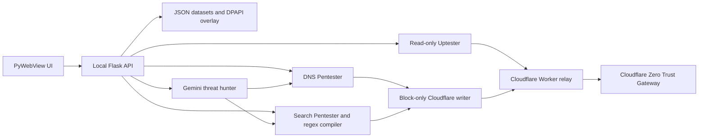

# SentinelGate AI

Secondary Strict Web Filter & On-Demand AI Threat Hunter targeting web proxies, CGI proxies, software/media downloaders, and obscure adult slip-throughs beyond Cloudflare Zero Trust, Google SafeSearch, and OS Standard User software restrictions.

## Structure

- `sentinelgate/` — Unified desktop application package
  - `main.py` — PyWebView desktop shell (DevTools disabled) & authenticated local bridge
  - `server.py` — Token-protected Flask API & background job runner
  - `config/cf_secrets.py` — Resolves the runtime-configured Worker transport; retains native sealed-transport support for legacy builds
  - `config/vault.py` — Windows DPAPI (`CryptProtectData`) vault for Gemini keys, Worker URL, and the app-to-Worker relay key; Cloudflare API credentials are excluded
  - `core/regex_engine.py` — Exact retained `CHAR_MAP` obfuscator, dynamic chunker & Rust DFA check
  - `core/cleaner.py` — Skeleton clustering deduplicator & 800x virtual brute-forcer
  - `core/cloudflare.py` — Read-only Gateway client and block-only policy writer, with quota handling and list/rule sharding
  - `core/gemini_agent.py` — On-demand Gemini slip-through threat hunter with model, key & saturation auto-stop
  - `core/storage.py` — JSON datasets plus a DPAPI-protected monotonic overlay for block additions
  - `modules/pentester.py` — Block-only policy writer (DNS + Search Pentester)
  - `modules/uptester.py` — Strictly read-only block enforcement & essential baseline monitor
  - `validator/` — Rust `cf_validator` RE2 512KB DFA compiler check
  - `installer/` — Single-file per-user Rust Windows installer & uninstaller (`SentinelGateAI-Setup.exe`, zero admin required)
  - `ui/` — Embedded HTML/CSS/JS desktop interface
- `worker/` — **Zero-Token Cloudflare Worker Relay** (`sentinelgate-relay.js`, `wrangler.toml`, `setup-worker.ps1`, [`worker/README.md`](worker/README.md)) so Cloudflare API credentials never ship to client computers
- `data/` — Consolidated blocklists, uptime baselines, and cached test states
- `tests/` — Automated verification suite
- `build.py` — **The single build script**: compiles a runtime-configured installer via Nuitka (`--onefile`) and produces `dist/SentinelGateAI-Setup.exe`
- `setup.ps1` — Developer dependency & environment installer (`.venv`, Python packages, Rust `cf_validator.exe`, tests)
- `clean.ps1` — Removes all regenerable dependencies, caches, and build artifacts

## How the Project Works

SentinelGate AI is a Windows desktop control panel backed by a local Python service. The WebView UI calls the Flask API on `127.0.0.1`; the service runs scans and policy sync jobs and returns their progress to the UI.



### Runtime and data flow

1. **The desktop shell starts locally.** `main.py` launches the WebView and a Flask server bound to loopback. Requests from the UI use a per-session token; the app removes proxy and custom certificate environment overrides before startup.
2. **Datasets feed scans.** DNS domains, search terms, and uptime baselines live in JSON files. The storage layer seeds missing files from built-in baselines, validates edits when they are reloaded, and records new block additions in an encrypted DPAPI overlay so a JSON edit cannot silently retract a previously recorded local block.
3. **Pentesters find and sync blocks.** The DNS Pentester checks domains and can append failed domains to Gateway domain lists. The Search Pentester compiles and chunks search terms into Gateway rules within policy and expression limits. The optional Gemini hunter finds additional candidate domains and terms; Gemini credentials are saved in the DPAPI vault.
4. **The Uptester only reads Cloudflare state.** It checks whether expected block rules are active and whether essential DNS/search baselines remain reachable. It does not create, update, or delete Gateway resources.
5. **The Worker holds Cloudflare API credentials.** The desktop app stores only the Worker URL and its shared relay key in the DPAPI vault. Requests use HTTPS and the `X-SG-Relay-Key` header. `CF_ACCOUNT_ID` and `CF_API_TOKEN` remain Worker Secrets managed in Cloudflare.

### Append-only protection

The policy writer creates enabled `block` rules and appends items to domain lists. The app sends list additions to the Worker as `PUT /v1/lists/<id>` with an `append` array. The relay validates that this is the only operation requested, then maps it to Cloudflare's `PATCH` append operation. This preserves existing items: [Cloudflare's native list `PUT`](https://developers.cloudflare.com/api/resources/zero_trust/subresources/gateway/subresources/lists/methods/update/) with a non-empty `items` array replaces the current list. List and policy `DELETE` calls are rejected by the relay, and the local writer also refuses deletes.

The relay details and exact routes are documented in [`worker/README.md`](worker/README.md).

## Scripts

### 1. Clean & Reinstall Environment

```powershell
.\clean.ps1
.\setup.ps1
```

### 2. Deploy Zero-Token Worker Relay (Keeps Cloudflare Keys Off Client PCs)

See the full step-by-step setup guide at [`worker/README.md`](worker/README.md). Summary:

1. Put `ACCOUNT_ID` and a least-privilege `API_TOKEN` into root `.env` for the initial Worker setup. They are uploaded as Worker Secrets and are not bundled into the client installer.
2. Authenticate Wrangler and deploy the Worker Relay + push all secrets from `.env`:
   ```powershell
   npx wrangler login
   .\worker\setup-worker.ps1
   ```
   This deploys `worker/sentinelgate-relay.js`, uploads `CF_ACCOUNT_ID`, `CF_API_TOKEN`, and `RELAY_CLIENT_SECRET` as encrypted Cloudflare Worker Secrets, and saves setup values to `.env`. Installed users configure the Worker URL and matching relay client key in the app's **API Vault & Security** page.

For later relay code changes, use the update script. It deploys Worker code without changing secrets or Gateway data, verifies the live relay, and attempts a rollback if post-deploy checks fail:

```powershell
.\worker\deploy-worker-update.ps1 -DryRun
.\worker\deploy-worker-update.ps1
```

### 3. Build Single-File Installer (`dist/SentinelGateAI-Setup.exe`)

There is one single build script ([`build.py`](build.py)) and it requires **no interactive prompts**. Run it to produce an installer; the Worker URL and relay client key are configured after install in the app:

```powershell
.\.venv\Scripts\python.exe build.py
```

`build.py` compiles the Rust validator, builds the desktop app with Nuitka, then packages it in the per-user Rust installer. It outputs `dist/SentinelGateAI-Setup.exe` without embedding the Worker URL, relay key, Cloudflare account ID, or Cloudflare API token. After installation, users enter the Worker URL and matching relay key in **API Vault & Security**; the app stores them in the per-user Windows DPAPI vault. Rotate `CF_API_TOKEN` as a Worker Secret in the Cloudflare dashboard without changing app code or rebuilding.

### 4. Installing, Editing JSONs & Uninstalling

- **Install**: Run `dist\SentinelGateAI-Setup.exe`. It installs `SentinelGateAI.exe` and `Uninstall.exe` to `%LOCALAPPDATA%\Programs\SentinelGateAI`, initializes `%LOCALAPPDATA%\Programs\SentinelGateAI\data\*.json`, ensures WebView2 Runtime is available, creates Desktop & Start Menu shortcuts (including **Uninstall SentinelGate AI**), and registers standard **Windows Installed Apps** uninstall metadata.
- **Edit JSON Files in Production**: Open `%LOCALAPPDATA%\Programs\SentinelGateAI\data\` in Explorer (**API Vault & Security → Open JSON Data Folder**) to edit `dns_blocklist.json`, `search_blocklist.json`, `dns_uptime_sites.json`, or `search_uptime_terms.json`, then select **Reload JSON Files**. The JSON files define the active local datasets used by the tool. Removing entries updates the explorer and subsequent local checks; already-pushed Cloudflare policies, lists, and items are retained because remote deletion is disabled.
- **Uninstall**: Uninstall anytime via **Windows Settings → Apps → Installed apps → SentinelGate AI → Uninstall**, via the Start Menu **Uninstall SentinelGate AI** shortcut, or by running:
  ```powershell
  "%LOCALAPPDATA%\Programs\SentinelGateAI\Uninstall.exe" --uninstall
  ```

## Running from Source & Tests

```powershell
.\.venv\Scripts\python.exe -m sentinelgate.main
.\.venv\Scripts\python.exe -m unittest discover -s tests -v
```

