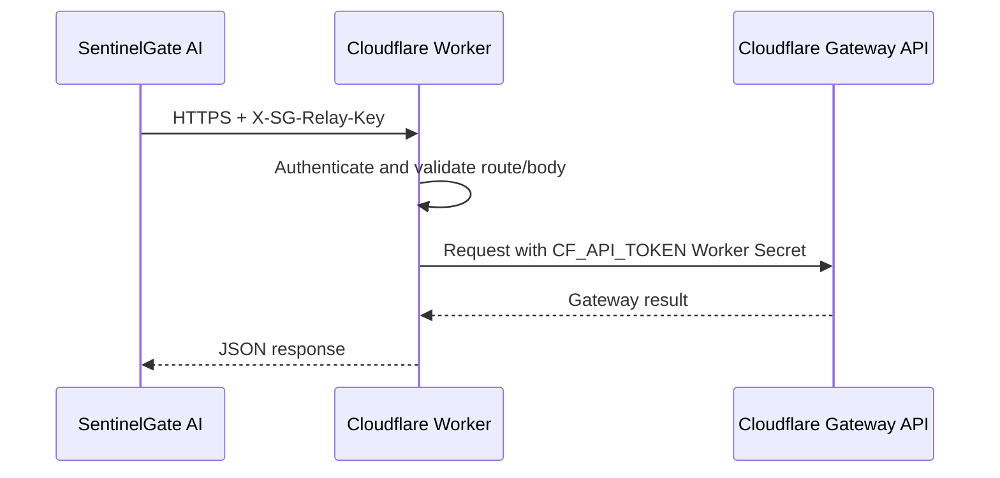

# SentinelGate AI — Zero-Token Cloudflare Worker Relay Setup Guide

The Worker is the server-side boundary between SentinelGate AI and Cloudflare Gateway. The desktop app sends authenticated requests to the Worker; the Worker uses its Cloudflare credentials to read or update Gateway. `CF_ACCOUNT_ID` and `CF_API_TOKEN` stay in Cloudflare Worker Secrets and are never placed in the desktop app or installer.

The desktop app stores the Worker URL (`WORKER_URL`) and app-to-Worker shared key (`RELAY_CLIENT_SECRET`) in its per-user Windows DPAPI vault. Both can be edited in **API Vault & Security** without rebuilding the app. The relay key is distinct from the Cloudflare API token: it authenticates the app to the Worker, while the Cloudflare token authorizes the Worker to access Gateway.

## Request Flow



The relay is deliberately narrow. It does not accept arbitrary upstream paths or methods; it forwards only the supported health, list, and rule operations described below.

---

## Security Properties Enforced by the Relay (`worker/sentinelgate-relay.js`)

Even if an attacker inspects a client computer, the real Cloudflare API credentials live solely inside Cloudflare's encrypted Worker runtime secrets:

1. **Cloudflare API credentials stay server-side:** `CF_ACCOUNT_ID` and `CF_API_TOKEN` are Worker Secrets. The desktop only stores the Worker endpoint and the separate relay client key in its DPAPI-protected vault.
2. **Client authentication (`X-SG-Relay-Key`):** Every route rejects missing or incorrect relay keys with `401 Unauthorized`; comparisons use a constant-time equality check.
3. **Server-side Block-Only Policy Firewall (`403 Forbidden`):**
   - `POST /v1/lists`: permits only `type: "DOMAIN"` lists.
   - `PATCH /v1/lists/:id`: accepts only an `append` array; `remove` and `items` replacement fields are rejected.
   - `PUT /v1/lists/:id`: the app-facing append operation. It accepts only an `append` array and maps it to Cloudflare `PATCH`. [Cloudflare documents](https://developers.cloudflare.com/api/resources/zero_trust/subresources/gateway/subresources/lists/methods/update/) that a native list `PUT` with nonempty `items` replaces the existing items, so the relay never forwards replacement payloads.
   - `POST /v1/rules` & `PUT /v1/rules/:id`: only enabled `block` rules are allowed.
   - Every `DELETE` request under `/v1/rules` or `/v1/lists` is rejected with `403`, including encoded paths, rules, lists, and list items. The relay never forwards a delete operation to Cloudflare.
4. **Transport:** The app sends requests over HTTPS with environment proxy overrides disabled. The Worker URL is editable in the app; the Cloudflare API token remains exclusively in Worker Secrets.

### Route summary

| App request | Worker behavior | Cloudflare operation |
| --- | --- | --- |
| `GET /v1/health` | Authenticates and checks Gateway | Reads rules and lists |
| `GET /v1/lists` or `/v1/lists/:id` | Reads list metadata/items | `GET` list endpoint |
| `POST /v1/lists` | Creates only a domain list | `POST` list endpoint |
| `PUT /v1/lists/:id` with `{ "append": [...] }` | Validates append-only payload | `PATCH` list endpoint with `append` |
| `PATCH /v1/lists/:id` with `{ "append": [...] }` | Same append-only behavior, retained for compatibility | `PATCH` list endpoint with `append` |
| `GET /v1/rules` | Reads rules | `GET` rules endpoint |
| `POST /v1/rules` | Creates enabled block rules only | `POST` rules endpoint |
| `PUT /v1/rules/:id` | Updates enabled block rules only | `PUT` rule endpoint |
| `DELETE /v1/rules/...` or `/v1/lists/...` | Always rejected | No request forwarded |

---

## Prerequisites

1. **Node.js 18+** (for `npx wrangler`) — verify with `node -v`.
2. **Cloudflare Zero Trust Account** + a **least-privilege API Token**:
   - In Cloudflare Dashboard -> **My Profile -> API Tokens -> Create Custom Token**:
     - Permissions:
       - `Account` -> `Zero Trust` -> `Edit`
       - `Account` -> `Account Settings` -> `Read` *(optional)*
     - Account Resources: Include -> your specific Cloudflare Account only.
     - **Do not** grant DNS zones, Billing, Workers Admin, or Account Admin permissions.
   - *(Recommended: if you previously tested or shared an older token in `.env` or chat, revoke it and create a fresh custom token now.)*

---

## Step 1: Configure Root `.env`

In the repository root, open `.env` (or copy `.env.example` to `.env`):

```dotenv
# Used ONLY when pushing encrypted Worker Secrets to Cloudflare (NEVER compiled into the desktop .exe)
ACCOUNT_ID="your-cloudflare-account-id"
API_TOKEN="your-scoped-cloudflare-zero-trust-api-token"

# Filled automatically by worker/setup-worker.ps1 (or set manually)
WORKER_URL="https://sentinelgate-relay.<your-subdomain>.workers.dev"
RELAY_CLIENT_SECRET="strong-random-relay-secret"
```

> Never commit `.env` to Git — `.env` is ignored by `.gitignore`.

---

## Step 2: Authenticate Wrangler & Deploy the Worker Relay

### Option A — Automated Deployment & `.env` Sync (Recommended)

1. Log in to Cloudflare once (opens browser OAuth):
   ```powershell
   npx wrangler login
   ```
2. Run the helper script from the project root — it deploys `worker/sentinelgate-relay.js`, generates `RELAY_CLIENT_SECRET` in `.env` if blank, captures your deployed `WORKER_URL` into `.env`, and pushes all 3 encrypted secrets directly from `.env`:
   ```powershell
   .\worker\setup-worker.ps1
   ```

### Option B — Manual Wrangler Commands

```powershell
cd worker
npx wrangler login
npx wrangler deploy

npx wrangler secret put CF_ACCOUNT_ID
npx wrangler secret put CF_API_TOKEN
npx wrangler secret put RELAY_CLIENT_SECRET
```

Then copy the deployed `https://sentinelgate-relay.<your-subdomain>.workers.dev` URL into `WORKER_URL` inside root `.env` (along with the same `RELAY_CLIENT_SECRET` you entered above).

### Updating Worker Code After Initial Setup

For later code-only changes to `sentinelgate-relay.js`, use the update script instead of rerunning the first-time setup. It checks the live relay, runs a JavaScript syntax check and Wrangler dry run, deploys without changing Worker secrets, then verifies health and that policy/list/item DELETE requests return `403`. If post-deploy checks fail, it attempts to roll back to the prior Worker version.

From the repository root:

```powershell
.\worker\deploy-worker-update.ps1 -DryRun
.\worker\deploy-worker-update.ps1
```

The dry run does not deploy. The second command publishes the code update. Neither command creates, edits, or deletes Cloudflare policies, lists, or list items. For changes to `.env` secrets or first-time setup, use `setup-worker.ps1` instead.

---

## Step 3: Verify Worker Relay Live

Test from PowerShell (replace values with your `.env` values):

```powershell
# Should return 401 Unauthorized without key:
Invoke-WebRequest -Uri "https://sentinelgate-relay.<your-subdomain>.workers.dev/v1/health" -SkipHttpErrorCheck | Select-Object StatusCode

# Should return 200 OK with {"ok": true, "rule_count": ..., "list_count": ...}:
Invoke-RestMethod -Uri "https://sentinelgate-relay.<your-subdomain>.workers.dev/v1/health" -Headers @{ "X-SG-Relay-Key" = "<RELAY_CLIENT_SECRET>" }
```

---

## Step 4: Build, Install, and Configure the Desktop App

`.env` is only needed for the Worker setup script and deployment checks. The installer build does not embed or require relay settings.

```powershell
.\.venv\Scripts\python.exe build.py
```

`build.py` builds the installer without Worker credentials. Run the resulting installer, start SentinelGate AI, then open **API Vault & Security** and enter the deployed Worker URL and matching relay client key. These settings are encrypted in the per-user Windows DPAPI vault. Later Worker URL or relay-key changes can be made there without rebuilding.

When users install `SentinelGateAI-Setup.exe`, they configure the Worker URL, relay client key, and optional Gemini keys inside the app UI (stored per-user via Windows DPAPI).

---

## Rotating Keys Later

- **Rotate Cloudflare `API_TOKEN`:** Create a new least-privilege token in Cloudflare, update the `CF_API_TOKEN` Worker Secret in the Cloudflare dashboard, verify the relay, then revoke the old token. Existing apps continue working; no source access or rebuild is needed.
- **Rotate `RELAY_CLIENT_SECRET`:** Update the Worker Secret in the Cloudflare dashboard, then enter the matching value in each app's **API Vault & Security** settings. No rebuild is needed.
